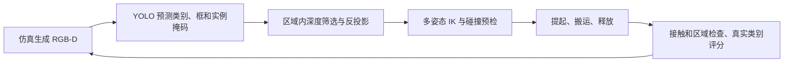

# RGB-D 机械臂视觉分拣

以**深度学习实例分割**为核心，研究“图像里识别得准，是否就能让机械臂放得准”。在 PyBullet 桌面场景中，模型预测立方体、圆柱和长方体的类别与掩码；结合相机标定和深度图估计抓取位置，再由 KUKA iiwa 完成分拣。项目包含训练、预测、控制、配对实验和失败分析的完整代码。

> 这是课程研究工程：代码提供完整流程，正式结论需要按实验协议训练和评测。`oracle` 是真实位姿诊断，不能作为深度学习成绩。夹取使用经过接触距离检查的固定约束，尚未模拟真实手指抓取。

## 研究问题与方法

原项目在固定演示中能成功，但我们复现的随机场景中出现 `no_valid_targets` 和 `joint_limits`。高检测 mAP 没有直接转化为高任务成功率。我们将问题拆成视觉区域选择、空间定位、机械臂执行和评价四个环节，逐项验证。

| 方法 | 图像信息 | 定位区域 | 目的与局限 |
|---|---|---|---|
| `oracle` | 仿真真实类别和位姿 | 真实顶面位置 | 诊断控制链路；不算学习方法 |
| `hsv` | 固定红/绿/蓝颜色规则 | 颜色轮廓 + 深度 | 可解释的传统基线，颜色变化时可能失效 |
| `yolo_box` | YOLO26 分割模型的类别与框 | 检测框 + 深度 | 与下行使用同一权重，比较背景混入的影响 |
| `yolo_mask` | YOLO26 预测实例掩码 | 掩码内部 + 深度 | 主要研究方法，掩码和深度错误仍会导致失败 |
| `hybrid` | 同一模型 + 颜色/形状检查 | 经检查或细化的掩码 | 研究规则的帮助与限制，保留颜色假设 |
| `yolov8_mask` | YOLOv8-seg | 预测掩码 + 深度 | 对照模型版本，需统一训练预算 |

**掩码**是每个实例对应的像素区域。预测掩码可以缩小读取深度的范围，减少桌面背景进入定位。它不自动保证抓取成功。当前代码输出分割指标、抓取坐标和完整分拣结果，并有相机几何测试；正式研究还应扩大定位误差评测。这里的深度学习发生在 YOLO 的训练与预测环节；IK、碰撞检查和运动控制是机器人算法。



运行时学习分支不读取仿真分割图，也不使用真实类别筛掉错误检测。仿真物体 ID、已知碰撞几何用于约束夹取和安全检查，真实类别仅在执行后评分；这仍是有已知物体几何的仿真研究，不能宣称未知真实环境部署。

## 环境与快速验证

建议 Python **3.11**、Windows 10/11 或 Linux，不依赖 ROS。已在 Windows / Python 3.11.9 / CPU PyTorch 上进行本地验证。NVIDIA 显卡用于 GUI 渲染不代表 PyTorch 已开启 CUDA。GPU 训练需要另行安装兼容的 PyTorch，先用 `doctor` 检查。

在仓库根目录执行。PowerShell 示例，每行单独执行：

```powershell
py -3.11 -m venv D:\robot_sort_env
D:\robot_sort_env\Scripts\Activate.ps1
python -m pip install -e ".[learning]"
python -m robosort doctor
python -m unittest discover -s tests -v
python -m robosort demo --method oracle --output results/oracle-demo --plots
python -m robosort demo --method hsv --output results/hsv-demo --gui
```

Linux/macOS 创建 `.venv` 后用 `source .venv/bin/activate`，其余命令相同。Windows 不使用 `source`。建议虚拟环境使用纯英文路径；必要时设置 `ROBOSORT_ASSET_DIR` 为英文资源缓存目录，项目会复制所需 PyBullet 资源。

默认无窗口运行，`--gui` 显示机械臂并使用实时动作。已有输出目录会拒绝覆盖；重跑请换目录名。详细操作见 [复现指南](docs/REPRODUCE.md)。

## 数据、训练与深度学习演示

下面是可复现的研究起点，并非保证最优的超参数。正式实验应扩大数据并固定版本。

```powershell
python -m robosort dataset --output datasets/v1 --count 600 --seed 42 --random-colors --random-lighting
python -m robosort check-dataset datasets/v1
python -m robosort train --data datasets/v1/segment.yaml --model yolo26n-seg.pt --output artifacts/yolo26-v1 --epochs 30 --imgsz 640 --batch 2 --device cpu --allow-download
python -m robosort validate --weights artifacts/yolo26-v1/best.pt --data datasets/v1/segment.yaml --output artifacts/yolo26-test --split test
python -m robosort predict --fixed --weights artifacts/yolo26-v1/best.pt --output results/prediction-demo
python -m robosort demo --method yolo_mask --weights artifacts/yolo26-v1/best.pt --output results/mask-demo --gui --plots
```

`--allow-download` 仅明确允许从 Ultralytics 获取训练初始权重；推理必须提供本地的、针对本项目三类物体训练过的分割权重。COCO 原始权重或旧项目的检测 `best.pt` 不能替代本项目分割模型。官方支持的模型名称与实例分割任务见 [YOLO26 文档](https://docs.ultralytics.com/models/yolo26/) 和 [分割文档](https://docs.ultralytics.com/tasks/segment/)。

数据按场景划分 70%/15%/其余为 train/val/test，包含负样本、可选颜色与光照变化。真值掩码只生成训练标签。保存场景参数、图像与标签哈希；同时导出检测标签，便于扩展实验。完整说明见 [训练说明](docs/TRAINING.md)。

## 配对实验

```powershell
python -m robosort scenes --count 30 --seed 1000 --regime standard --output datasets/eval-standard.json
python -m robosort evaluate --catalogue datasets/eval-standard.json --methods oracle hsv yolo_box yolo_mask hybrid --weights artifacts/yolo26-v1/best.pt --output results/standard-v1 --plots
python -m robosort summarize results/standard-v1
```

更换 `--regime color`、`lighting`、`stress` 生成独立压力测试清单，分别报告结果。比较 YOLOv8 时先用相同数据训练 `yolov8n-seg.pt`，再加入 `--methods ... yolov8_mask --yolov8-weights artifacts/yolov8-v1/best.pt`。检测框/掩码消融始终使用同一分割权重，控制器及预算一致。

每次输出包含场景清单、逐轮 `results.jsonl`、CSV、汇总、模型哈希及时间记录。完整成功率、每物体正确放置率、错分、提起和拒绝原因分别统计。缺测时间保留为空；提前失败的短耗时不解释为更高效率。详见 [实验协议](docs/EXPERIMENT_PROTOCOL.md)。

## 实际验证与边界

[验证记录](docs/VERIFICATION.md) 记录本版本真正运行过的检查；[examples/verification](examples/verification) 保存可审计的烟测记录。烟测只能证明接口和一部分场景能工作，不能代替多种子、多场景正式实验。未训练的模型不会被伪装成可用权重，未运行的实验不填造分数。

当前对象为已知尺寸的三类简单形状，每类最多一个；固定标定相机、理想同步深度、约束夹取。标准场景保持间距，拥挤场景单独评估。尚未验证真实机械臂、真实 RGB-D 相机、复杂遮挡、多物体同类和物理指爪。CPU 可运行，训练与轨迹预检可能较慢。

## 代码与来源

- `robosort/`：新研究流程、数据、深度学习、RGB-D 定位、执行及统计。
- `robot/`、`core/`：沿用并修改的基础运动模块。
- `simulation/`、`perception/`：保留上游参考实现；新流程使用 `python -m robosort`。
- `tests/`：合成数据、相机几何、真值隔离、动作后端与评价正确性检查。
- `docs/`：复现、训练、实验协议与验证说明。

基于 [DiyaJabin/vision-based-robotic-arm](https://github.com/DiyaJabin/vision-based-robotic-arm) 发展。新增内容和原项目边界见 [UPSTREAM.md](UPSTREAM.md)。整体采用 AGPL-3.0-or-later，原 MIT 部分保留 [原许可](LICENSES/upstream-MIT.txt)。第三方依赖和模型权重遵循各自许可。
